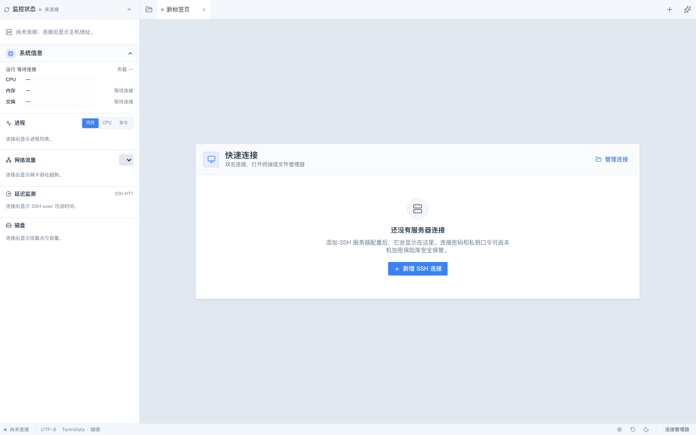
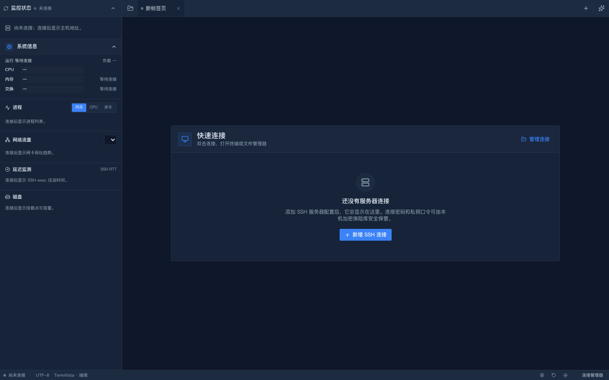
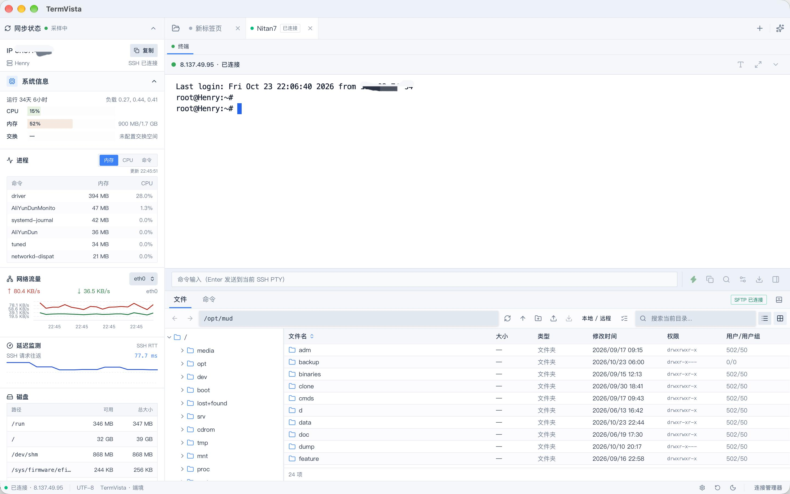
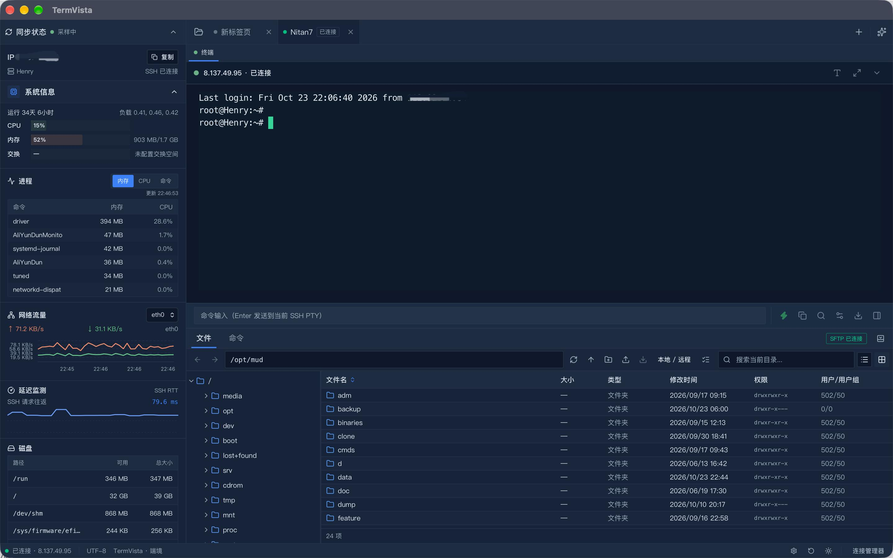
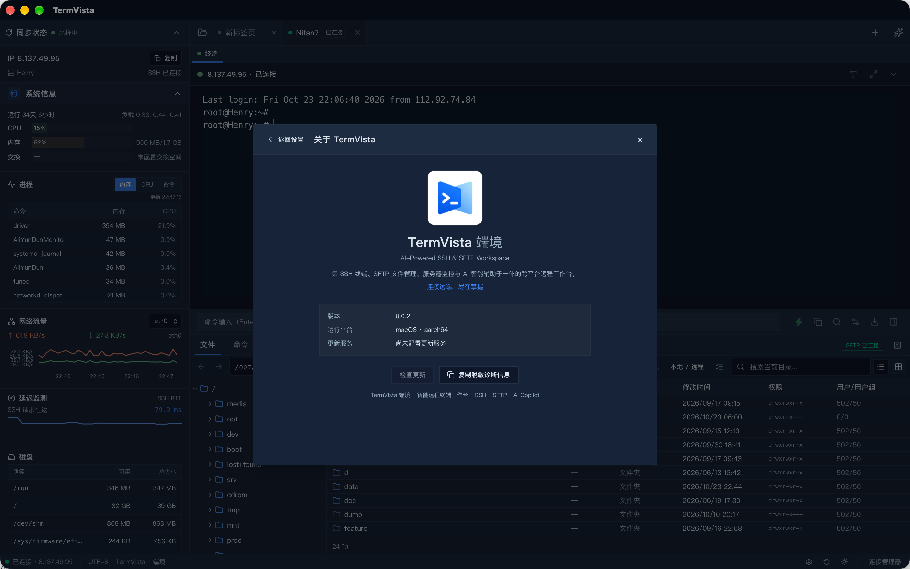
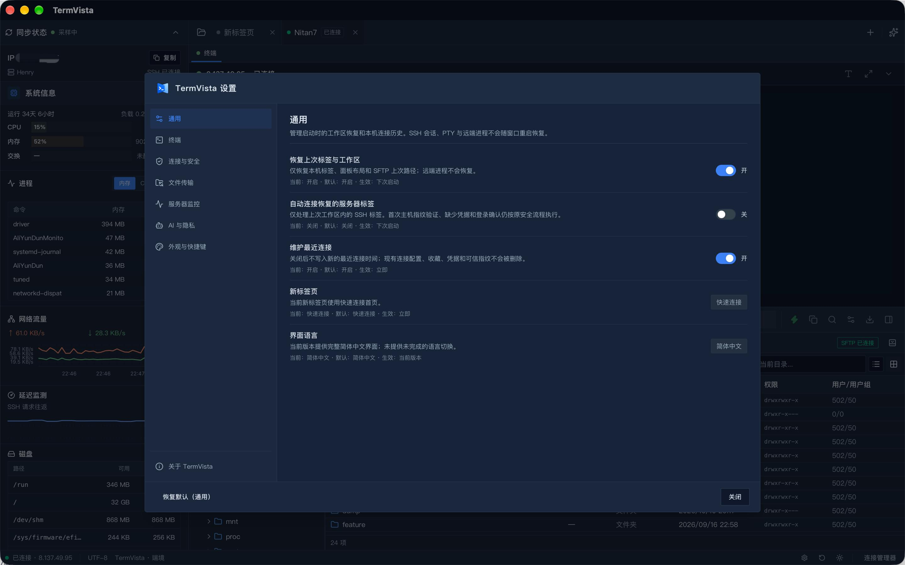

# TermVista

**Your remote workspace, in one place.** TermVista is a desktop SSH workspace for macOS and Windows, bringing terminals, SFTP file management, server monitoring, remote file editing, and user-authorized AI assistance together.

**Current application version: 0.10.24**

[Website](https://auyang.github.io/TermVista/) · [简体中文](README.zh-CN.md) · [日本語 (Japanese)](README.ja.md) · [繁體中文](README.zh-TW.md)

## Screenshots

The home screen images below are browser previews of the disconnected state, showing light and dark themes. They are not screenshots of the native Tauri window.

| Light theme | Dark theme |
| --- | --- |
|  |  |

The following images show a connected workspace and application settings.

| Connected workspace (light) | Connected workspace (dark) |
| --- | --- |
|  |  |

| About TermVista | Application settings |
| --- | --- |
|  |  |

## New in 0.10.24

- **Four-language interface:** Switch between English, Simplified Chinese, Japanese, Traditional Chinese, or follow the system language. The interface updates immediately.
- **AI Copilot 2.0:** Connect a local Ollama model or an OpenAI-compatible provider. With your approval, Copilot can use selected terminal, editor, SFTP, and monitoring context for explanations and evidence-linked diagnostics. It can draft shell commands and Monaco code diffs; commands are only placed in the command bar for you to review and run, and code suggestions remain local until you apply and save them.
- **Signed in-app updates:** Check for updates from About, optionally check at startup, and view release notes and download progress. Update packages must pass signature verification. Installation waits for unfinished editing, transfers, diagnostics, AI requests, and other maintenance tasks; active SSH sessions or tunnels require confirmation before they are interrupted.
- **Quicker return to work:** Search connection profiles, mark favorites, and find recent connections. Restore local server tabs, panel layout, and each server’s last SFTP path after restart. Reconnecting restored tabs is optional and follows the normal host-key and authentication flow; remote shells and processes are never restored.

## Workspace features

- **SSH terminals:** Password and private-key authentication, multiple isolated session tabs, interactive PTY terminals, reconnect controls, and a command bar that uses the active PTY.
- **SFTP file management:** Browse remote folders in a directory tree and file list, switch to local/remote dual-pane browsing, and transfer files by drag and drop. The transfer queue shows progress and supports cancellation, retry, and conflict choices.
- **Remote file editing:** Open remote text files in Monaco Editor, work across multiple server and file tabs, use syntax highlighting, and review unsaved changes and remote-file conflicts before saving.
- **Server monitoring and port forwarding:** View remote CPU, memory, process, network, and disk information. Configure SSH local forwarding for MySQL, PostgreSQL, Redis, or custom TCP services. Tunnel listeners bind to 127.0.0.1 and stop when their SSH session disconnects or the app exits.
- **Workspace appearance:** Use light or dark themes and adjust the monitor, terminal, editor, and SFTP workspace layout.

## Security and privacy

- TermVista records a trusted SSH host fingerprint after you confirm it. Later connections verify the fingerprint; a changed fingerprint blocks the connection and prompts you to review it.
- SSH passwords and private-key passphrases can be saved in secure local credential storage. TermVista does not fall back to storing them in plaintext.
- AI never executes SSH commands or writes remote files. You choose and review context before sharing it; diagnostic actions require individual authorization. Generated commands need your manual review and execution, and code suggestions require you to apply and save them.
- Connection profiles, trusted host records, and saved credentials stay on your device and are not included in this source repository or application packages.
- Local port forwarding listens only on 127.0.0.1. Other processes on your computer can still access a forwarded service, so review the destination before starting a tunnel.

## Download

Installers are published on [GitHub Releases](https://github.com/auyang/TermVista/releases).

| Platform | Package |
| --- | --- |
| Windows x64 | NSIS installer (.exe) |
| macOS Intel | Disk image (.dmg) |
| macOS Apple Silicon | Disk image (.dmg) |

Linux installers are not currently provided. Windows installers are not code-signed. macOS packages use ad-hoc signing and are not notarized, so your operating system may show a security warning when opening them.

## Quick start

1. Download and install TermVista for your platform.
2. Add an SSH server profile with its host, port, username, and authentication method.
3. On the first connection, compare the displayed host-key fingerprint with a trusted source before accepting it. Saving the login credential locally is optional.
4. Use the session tab to work in the terminal and SFTP panes. Double-click a remote text file to open it in the editor.
5. To use AI Copilot, configure an Ollama or OpenAI-compatible provider, select the context to share, and review the authorization preview.

## Run from source

The development environment requires Node.js 22, pnpm 10.32.1, Rust stable, and the platform dependencies required by Tauri 2.

    pnpm install --frozen-lockfile
    pnpm tauri dev

To run only the frontend preview, use pnpm dev. This does not open an SSH connection or display fabricated server-monitoring data.

## Checks

Run the project checks with:

    pnpm i18n:check
    pnpm typecheck
    pnpm lint
    pnpm test:polish
    pnpm build
    cargo fmt --check --manifest-path src-tauri/Cargo.toml
    cargo clippy --offline --manifest-path src-tauri/Cargo.toml --all-targets -- -D warnings
    cargo test --offline --manifest-path src-tauri/Cargo.toml

## License

TermVista is distributed under the [Apache License 2.0](LICENSE).

## Links

- Source code: [github.com/auyang/TermVista](https://github.com/auyang/TermVista)
- Official website: [auyang.github.io/TermVista](https://auyang.github.io/TermVista/)
- Bug reports and feature requests: [GitHub Issues](https://github.com/auyang/TermVista/issues)
- Installers and releases: [GitHub Releases](https://github.com/auyang/TermVista/releases)
